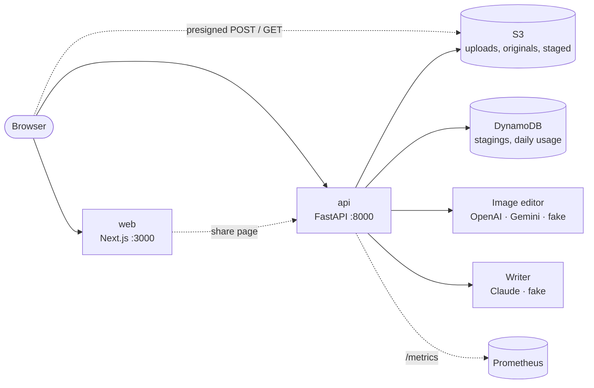

# Architecture

> Keep this page current: update it in the same pull request that changes the architecture.
> The target design is in [scope.md](scope.md). This page describes what is **built** today.

## Context

Heya turns a photo of an empty or dated room into a staged one, in a chosen style, and writes the furniture
list and listing description. It is part 1 of AI on EKS and teaches the basics of running a web app on
Amazon EKS properly. The AI work happens in hosted APIs; the cluster runs stateless web and API pods.

## Built so far

| Component | Responsibility | Tech | Status |
|---|---|---|---|
| `web` | The studio (upload, style, compare, shop the look, listing) and the share page | Next.js 16, React 19, TypeScript, Tailwind CSS | Done, runs locally ([ADR 0004](adr/0004-web-app-and-one-domain.md)) |
| `api` | Uploads, staging, furniture list, listing text, daily limits | Python 3.13, FastAPI, boto3, Pillow, numpy | Done, runs locally |
| S3 | Photos: `uploads/`, `originals/` (no metadata), `staged/` (labelled) | moto locally; S3 in AWS (phase 1) | Done locally |
| DynamoDB | `staging#…` records, `usage#…` counters with TTL | moto locally; DynamoDB in AWS (phase 1) | Done locally |
| Image editor | Stage the room | OpenAI `gpt-image-2`, Gemini `gemini-3.1-flash-image`, fake | Done ([ADR 0002](adr/0002-ai-providers-behind-one-interface.md)) |
| Writer | Furniture list and listing text | Claude `claude-opus-5-5` with structured output, fake | Done |

The staging request, step by step: read the upload from S3; strip metadata and resize (rule R3); count the call
against the three daily limits in one DynamoDB transaction (rule R4); stage with the image model; resize the
result to the original's size; score the structure (rule R2); burn in the label (rule R1); store both photos and
the record.

The browser calls the API itself, never through the web app: locally at `PUBLIC_API_URL`
(`http://localhost:8000`), in AWS on the same domain, where the load balancer sends `/v1` to the API. Only the
share page talks to the API from the server (`API_URL`), so link previews get its title and photo. Both addresses
are read per request, so one image runs in every environment. Planned components (Terraform, Kubernetes) are in
the [roadmap](roadmap.md).

## Runtime contract (every service)

| Concern | How |
|---|---|
| Liveness | `GET /healthz`: process is up; never checks dependencies |
| Readiness | `GET /readyz`: 503 until started and during shutdown |
| Metrics | `GET /metrics`: Prometheus `http_requests_total`, `http_request_duration_seconds` |
| Logs | One JSON line per event on stdout, with `request_id` |
| Shutdown | On SIGTERM: stop taking new connections, finish in-flight requests (API: ≤ 20 s), exit 0 |
| Config | Environment variables only; secrets from the platform's secret manager |
| Security | Non-root user, read-only filesystem, no capabilities, minimal base image |

## Data

Photos in S3 (originals and staged versions, metadata stripped), stagings and daily usage in one DynamoDB
table. No database server to run. Visitor ids and IPs are stored hashed; usage counters expire after two days.
See [ADR 0003](adr/0003-s3-presigned-uploads-and-dynamodb.md).

## Deployment

Planned: Terraform for AWS; Kustomize manifests applied once by hand, then synced by Argo CD from `main`.
Roll back by reverting the commit.

## Reliability

SLOs are written in phase 2 of the [roadmap](roadmap.md), each with an alert and the runbook it links to.

## Security

Trust boundaries and controls: see [threat-model.md](threat-model.md).

## Decisions

See [adr/](adr/).
