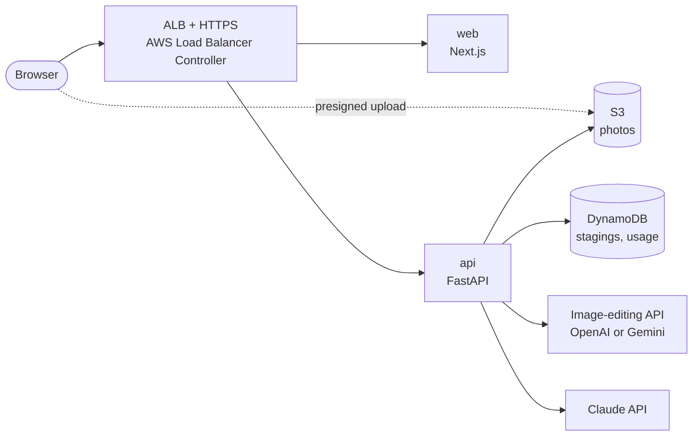

# Scope

Heya (部屋, "room") turns a photo of an empty or dated room into a furnished one, in the style the buyer likes. It
is part 1 of AI on EKS and teaches the basics of running a web app on Amazon EKS properly.

- **It is** a virtual-staging app for real-estate agents and home sellers: upload a room photo, pick a style, get a
  staged photo, a furniture list and a listing description. It runs on a production-grade EKS setup.
- **It is not** a photo editor for hiding problems. It adds furniture and decor only; it never changes walls,
  windows, doors, floors or views.

## Why real estate

Empty rooms photograph badly, and physical staging costs money and takes days. Virtual staging is already a service
agents pay for, so the demo needs no explanation: an empty room becomes a furnished one. It is also the simplest
shape of an AI app (a web page, an API and a hosted model), which makes it the right place to learn EKS itself.

## The product

| Actor | Does |
|---|---|
| Agent or seller | Uploads room photos, picks styles, downloads staged photos and the listing text |
| Buyer | Opens a share page with the before/after slider |

1. **Upload:** a room photo (JPEG, PNG or WebP, up to 10 MB) goes straight to S3 with a presigned URL. Location
   data (EXIF GPS) is removed.
2. **Stage:** pick Japandi, Scandinavian, Industrial or Modern. The image model adds furniture; the room stays the
   same.
3. **Check:** an automatic check compares the room's structure before and after, and flags photos where walls,
   windows or doors moved.
4. **Shop this look:** Claude lists the main pieces in the staged photo (type, colour, material) with search links.
5. **Listing:** Claude writes a listing description from the photos and the facts the agent enters (rooms, size,
   area).
6. **Share:** a page with the before/after slider and the "Virtually staged" label.

**API (v1):** `POST /v1/uploads` (presigned URL), `POST /v1/stagings`, `GET /v1/stagings/{id}`,
`POST /v1/listings`, `GET /v1/share/{id}`.

## Rules

| # | Rule | Enforced by |
|---|---|---|
| R1 | Every staged photo is labelled "Virtually staged" and is always shown with its original. | Label added to the image and the share page; an original is never deleted while a staging uses it |
| R2 | Furniture and decor only: no changes to walls, windows, doors, floors or views. | Instructions to the model, plus a structure check (edge maps before vs after) that flags failures for review |
| R3 | Photos carry no location data. | EXIF removed on upload, before storage |
| R4 | AI spend is capped. | Per-visitor daily limit, a global daily budget, alerts at 80% |

## Architecture (target)

Web and API run on EKS across three Availability Zones. The HPA scales both; Argo CD syncs the manifests from git.

## What it teaches on Kubernetes

Part 1 starts from zero:

- Terraform for the VPC and EKS, with a managed node group (Karpenter arrives in part 3)
- Deployments, Services, probes, resource requests and limits, PodDisruptionBudgets
- Ingress with the AWS Load Balancer Controller, an ACM certificate and ExternalDNS for the domain
- HorizontalPodAutoscaler with metrics-server
- EKS Pod Identity for S3 and DynamoDB, so there are no AWS keys in the cluster
- API keys in a Kubernetes Secret created from AWS Secrets Manager (part 2 automates this with External Secrets)
- Kustomize applied once by hand; then Argo CD owns the cluster

## AI providers

| Task | Provider | Why |
|---|---|---|
| Stage the room | OpenAI or Gemini image editing, behind one interface | Both edit a photo from instructions; an ADR records which keeps the room's structure best, and their speed and price |
| Furniture list, listing text | Claude (vision) | Reads the staged photo and writes in the agent's tone |

Tests use recorded responses, so CI never calls a paid API.

## Results to publish

| Number | How it is measured |
|---|---|
| p95 time to a staged photo | At the API, per image provider |
| Requests per second and p95 latency at 2, 4 and 8 pods | Load test (k6) with the AI provider mocked, so it measures the platform |
| HPA scale-up time | From load start to new pods ready |
| Failed requests while pods and a node are killed | Drill during the load test |
| Cost per hour of the cluster, and per staged photo | AWS Cost Explorer and the provider's bill |

## Out of scope (v1)

User accounts and payments, video walkthroughs, 3D tours, removing existing furniture ("decluttering").
